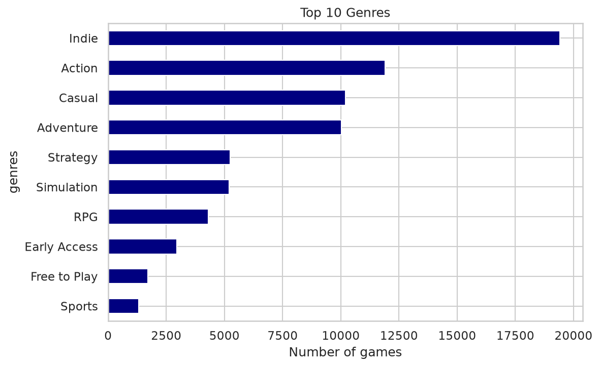
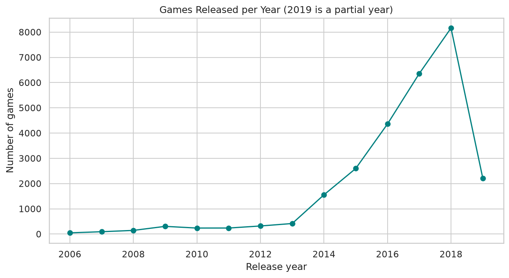
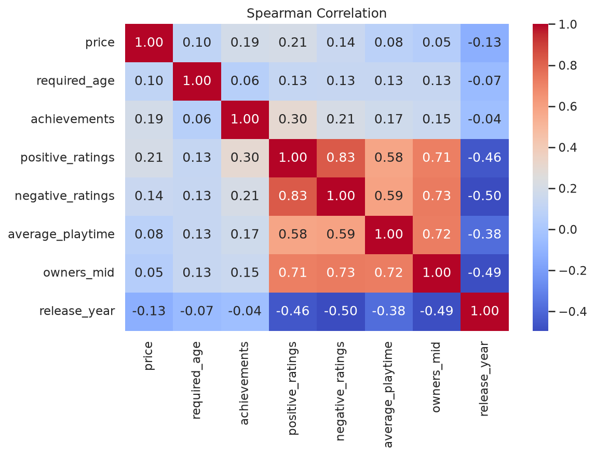

# Steam Store Games Analysis Using Python

Exploratory data analysis (EDA) of ~27,000 games on the Steam Store: data cleaning, summary statistics and nine visualizations covering genres, pricing, release trends, platform support, ratings and correlations.

**Group:** LMK

| Name | Enrollment No. |
|---|---|
| Lakshya Modi | IU2441230640 |
| Khant Mansiben Dhirendrasinh | IU2441230627 |

---

## Table of Contents

1. [Objectives](#objectives)
2. [Dataset](#dataset)
3. [Methodology](#methodology)
4. [Visualizations](#visualizations)
5. [Key Findings](#key-findings)
6. [Technologies Used](#technologies-used)
7. [Repository Structure](#repository-structure)
8. [How to Run](#how-to-run)
9. [Limitations](#limitations)

---

## Objectives

- Clean the dataset: check missing values, duplicate records, data types and outliers.
- Analyze the distribution of game prices and compare free vs. paid games.
- Study the distribution of game genres and compare average prices across genres.
- Analyze the number of games released over the years.
- Analyze the platforms supported by Steam games.
- Investigate the relationship between price and user ratings.
- Identify strongly related numerical features using correlation analysis.
- Summarize the findings in a short insights report ([project_report.md](project_report.md)).

## Dataset

| | |
|---|---|
| **Name** | Steam Store Games |
| **Source** | [Kaggle: nikdavis/steam-store-games](https://www.kaggle.com/datasets/nikdavis/steam-store-games) |
| **Size** | 27,075 games x 18 columns |
| **Release dates covered** | 1997 - May 2019 |

Columns in the raw file (`dataset/steam.csv`):

| Column | Description |
|---|---|
| `appid`, `name` | Unique Steam app ID and game title |
| `release_date` | Release date |
| `english` | Whether English is supported |
| `developer`, `publisher` | Developer(s) / publisher(s) |
| `platforms` | Supported platforms (`windows;mac;linux`) |
| `required_age` | Minimum required age |
| `categories`, `genres`, `steamspy_tags` | Feature categories, genres and user-assigned tags (`;`-separated lists) |
| `achievements` | Number of achievements |
| `positive_ratings`, `negative_ratings` | Number of positive / negative user reviews |
| `average_playtime`, `median_playtime` | Playtime statistics (minutes) |
| `owners` | Estimated owner range (e.g. `10000000-20000000`) |
| `price` | Price in USD (0 = free) |

> **Note:** this version of the dataset has no Metacritic column. The price-vs-quality analysis therefore uses the **positive review percentage** computed from user ratings instead (see [Limitations](#limitations)).

## Methodology

1. **Load** the raw CSV (preserved unchanged as `dataset/steam.csv`).
2. **Missing values:** `developer` (1) and `publisher` (14) were the only columns with nulls; filled with `"Unknown"`.
3. **Duplicates:** no duplicate rows and no duplicate `appid`s. 42 repeated game names were kept because they have different `appid`s (distinct products).
4. **Data types:** `release_date` to datetime, `english` to bool, `required_age` to `int8`; `owners` ranges converted to a numeric midpoint (`owners_mid`).
5. **Feature engineering:** `release_year`, `total_ratings`, `positive_pct`, `is_free`, `mac`, `linux`, plus 99th-percentile-capped copies of skewed columns for plotting.
6. **Outliers:** detected with the 1.5 x IQR rule. Extreme values were **kept** (they are legitimate, e.g. professional software priced at $150+) and capped only for visualization.
7. **EDA and visualization** with Pandas, NumPy, Matplotlib and Seaborn.
8. **Output:** cleaned data saved to `dataset/steam_cleaned.csv` (28 columns).

## Visualizations

All charts are generated by the analysis script and saved in [`graphs/`](graphs/).

| # | Chart | Type | File |
|---|---|---|---|
| 1 | Top 10 genres | Bar chart | `genre_distribution.png` |
| 2 | Price distribution (paid games) | Histogram + KDE | `price_distribution.png` |
| 3 | Price outliers | Box plot | `price_outliers.png` |
| 4 | Games released per year | Line chart | `games_released_per_year.png` |
| 5 | Free vs. paid games | Count plot | `free_vs_paid.png` |
| 6 | Price vs. positive rating % | Scatter plot | `price_vs_rating.png` |
| 7 | Average price by genre | Bar chart | `average_price_by_genre.png` |
| 8 | Correlation heatmap | Heatmap (Spearman) | `correlation_heatmap.png` |
| 9 | Platform support | Bar chart | `platform_support.png` |





## Key Findings

- **Indie dominates:** 71.7% of games carry the *Indie* tag, followed by Action (44.0%), Casual (37.7%) and Adventure (37.1%). Games can have several genres, so percentages overlap.
- **Games are cheap:** the median paid price is **$4.79**, 80% of paid games cost $10 or less, and the distribution is strongly right-skewed.
- **Most games are paid:** 90.5% paid vs. 9.5% free (2,560 games).
- **Release boom:** 69.7% of all games were released in 2016-2018; yearly releases grew from 418 (2013) to 8,160 (2018). 2019 is a partial year (data ends May 2019).
- **Windows is universal:** about 100% of games support Windows, 29.8% support Mac and 19.3% support Linux.
- **Price barely predicts rating:** Spearman correlation between price and positive-rating % is only **0.15** (weak positive).
- **Genre pricing:** among genres with 100+ paid games, *Utilities* ($19.64), *Massively Multiplayer* ($8.98) and *Sports* ($8.69) are priciest; *Casual* ($4.50) and *Indie* ($5.49) are cheapest.
- **Popularity metrics move together:** positive vs. negative ratings (0.83), owners vs. playtime (0.72) and owners vs. ratings (0.71-0.73) are strongly correlated, while price is weakly correlated with everything (max 0.21).

See [project_report.md](project_report.md) for the full analysis.

## Technologies Used

| Tool | Purpose |
|---|---|
| Python 3.11 | Main language |
| Pandas | Loading, cleaning, transformation, analysis |
| NumPy | Numerical operations |
| Matplotlib | Base plotting |
| Seaborn | Statistical visualizations |
| SciPy | KDE support for Seaborn |
| VS Code | Development |
| Git / GitHub | Version control and hosting |

## Repository Structure

```
Steam_Store_Games_Analysis/
│
├── dataset/
│   ├── steam.csv                  # raw data (unchanged)
│   └── steam_cleaned.csv          # cleaned + engineered data
│
├── notebooks/
│   └── steam_store_games_analysis.py   # full analysis script
│
├── graphs/
│   ├── genre_distribution.png
│   ├── price_distribution.png
│   ├── price_outliers.png
│   ├── games_released_per_year.png
│   ├── free_vs_paid.png
│   ├── price_vs_rating.png
│   ├── average_price_by_genre.png
│   ├── correlation_heatmap.png
│   └── platform_support.png
│
├── README.md
├── requirements.txt
└── project_report.md
```

## How to Run

Requires **Python 3.11+**.

```bash
# 1. Clone the repository
git clone https://github.com/Lakshya24382/Steam_Store_Games_Analysis.git
cd Steam_Store_Games_Analysis

# 2. (Recommended) create and activate a virtual environment
python3 -m venv venv
source venv/bin/activate          # Windows: venv\Scripts\activate

# 3. Install dependencies
pip install -r requirements.txt

# 4. Run the analysis from the repository root
python notebooks/steam_store_games_analysis.py
```

The script must be run **from the repository root** because it uses relative paths (`dataset/steam.csv`, `graphs/`). It prints data-quality checks and summary statistics to the console, regenerates all charts in `graphs/` and rewrites `dataset/steam_cleaned.csv`.

To also pop up each chart window while running, set `SHOW_PLOTS = True` near the top of the script.

## Limitations

- **No Metacritic data:** the dataset has no Metacritic column, so price is compared with the user-review positive percentage (paid games with at least 50 reviews, n = 10,257).
- **Estimated ownership:** `owners` is a range estimate, not an exact count; the midpoint is used.
- **Zero playtime:** 77.2% of games record an average playtime of 0, which likely reflects missing or unrecorded data rather than nobody playing.
- **Snapshot in time:** the data ends in May 2019, so prices, ratings and genre mix have since changed.
- **Correlation is not causation:** the correlations describe this dataset only.

## Data Source

Dataset published on Kaggle by user `nikdavis`: <https://www.kaggle.com/datasets/nikdavis/steam-store-games>. Please refer to the Kaggle page for the dataset's license and terms of use.