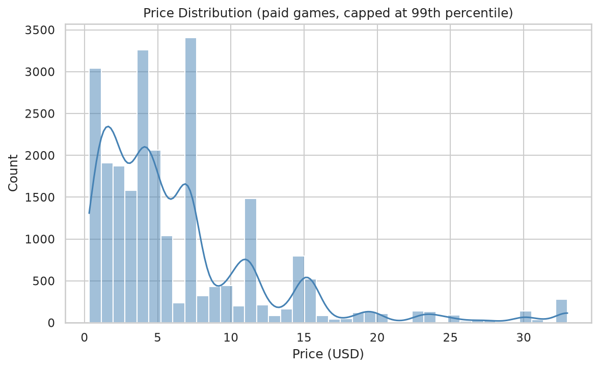
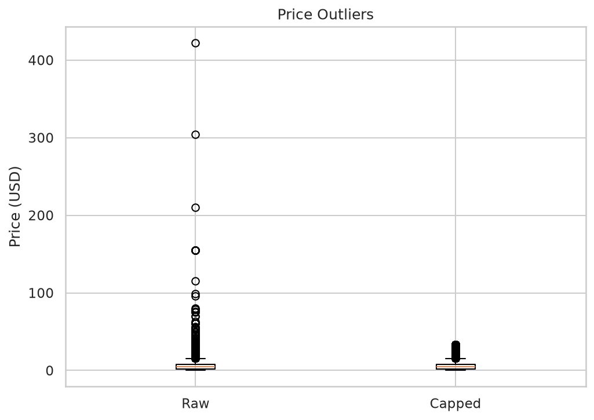
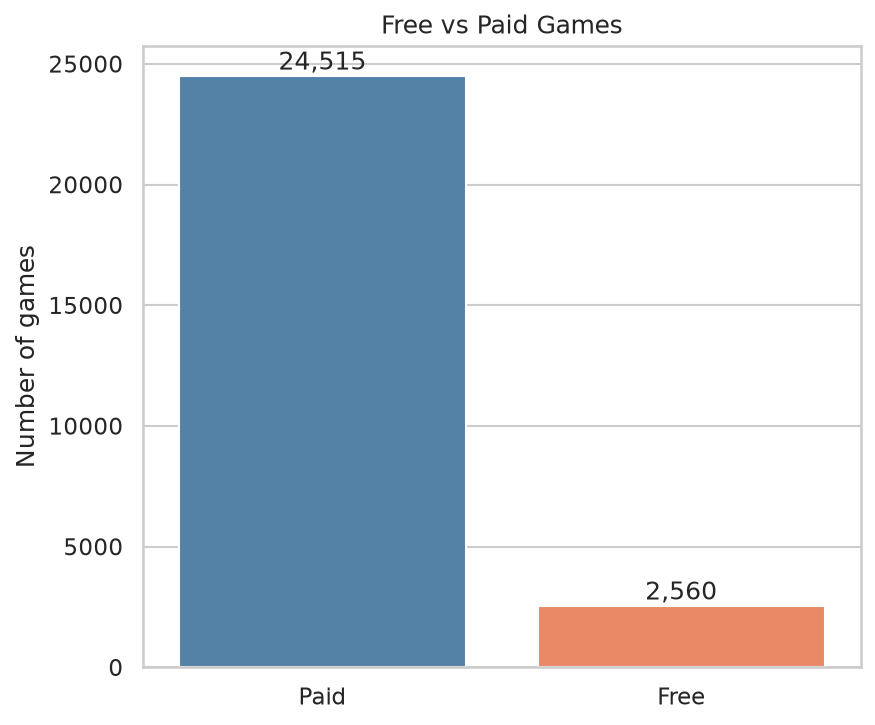
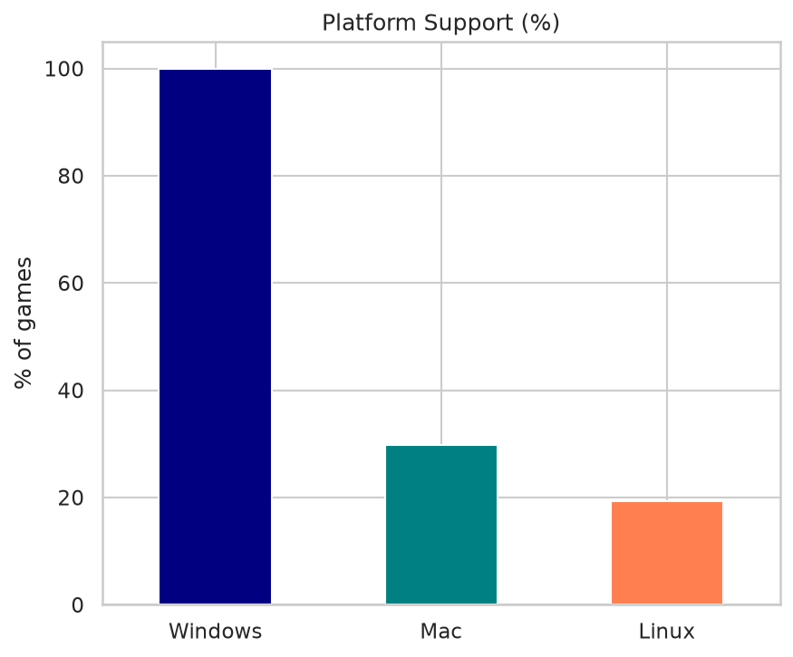
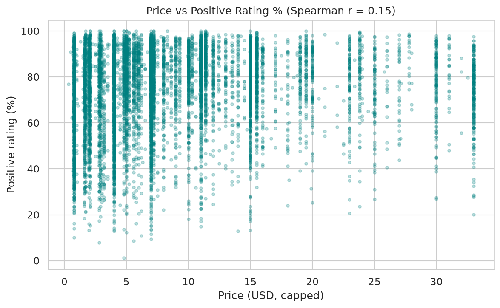
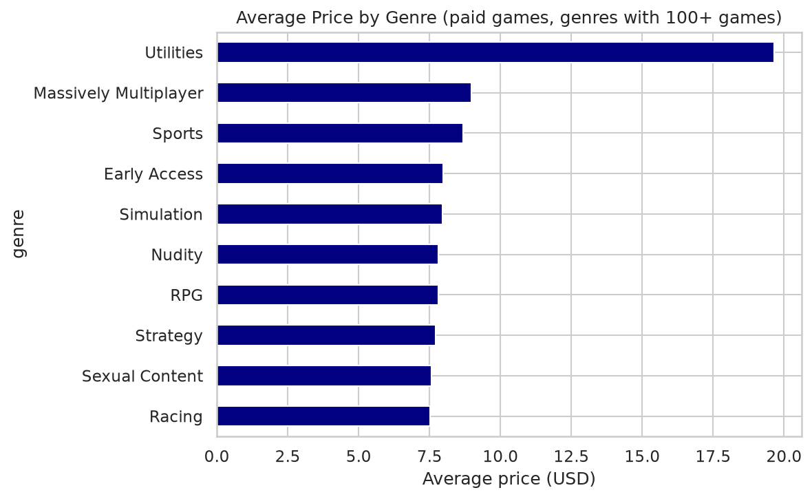

# Steam Store Games Analysis: Insights Report

**Group:** LMK
**Team:** Lakshya Modi (IU2441230640), Khant Mansiben Dhirendrasinh (IU2441230627)
**Dataset:** [Steam Store Games (Kaggle)](https://www.kaggle.com/datasets/nikdavis/steam-store-games)
**Tools:** Python, Pandas, NumPy, Matplotlib, Seaborn

---

## 1. Executive Summary

We analyzed 27,075 games from the Steam Store (released between 1997 and May 2019). After cleaning the data, we built nine visualizations to study genres, pricing, release trends, platform support, ratings and correlations.

The headline findings:

- Steam is dominated by **cheap, indie games**: 71.7% carry the Indie tag and the median paid price is only **$4.79**.
- Releases **exploded after 2013**, growing from 418 games in 2013 to 8,160 in 2018. 69.7% of all games were released in 2016-2018.
- **Price has almost no relationship with user rating** (Spearman 0.15).
- Review counts, owners and playtime rise together, so the strongest correlations in the data reflect **popularity**, not price or quality.

## 2. Dataset Overview

| Item | Value |
|---|---|
| Records | 27,075 games |
| Columns (raw / cleaned) | 18 / 28 |
| Release date range | 1997-06-30 to 2019-05-01 |
| Numeric fields | `price`, `required_age`, `achievements`, `positive_ratings`, `negative_ratings`, `average_playtime`, `median_playtime` |
| Categorical / list fields | `genres`, `categories`, `steamspy_tags`, `platforms` (`;`-separated), `developer`, `publisher`, `owners` (range string) |

**Differences from the original proposal.** The proposal anticipated about 29,235 records and 39 columns, including Metacritic scores and `price_overview`. The Kaggle file actually used has 27,075 records and 18 columns and **contains no Metacritic data**. Two adjustments follow from this:

1. Objective "price vs. Metacritic score" was answered with **price vs. positive-review percentage** (`positive_ratings / (positive + negative)`), which is a user-based quality measure.
2. The correlation heatmap uses the numeric fields that exist (price, age, achievements, ratings, playtime, owners, release year).

A ninth chart (platform support) was added beyond the eight proposed.

## 3. Data Quality and Cleaning

| Check | Result | Action |
|---|---|---|
| Missing values | Only `developer` (1 row) and `publisher` (14 rows) | Filled with `"Unknown"`; 0 nulls remain |
| Duplicate rows | 0 | None needed |
| Duplicate `appid` | 0 | None needed |
| Repeated game names | 42 | **Kept**: different `appid`s mean different products |
| Wrong data types | `release_date` stored as text; `english` as 0/1; `owners` as a range string | Converted to datetime, bool and numeric midpoint (`owners_mid`) |
| Memory-efficient types | `required_age` | Cast to `int8` |
| Inconsistent formats | Leading/trailing spaces in `name` | Stripped |

**Engineered columns:** `release_year`, `owners_mid`, `total_ratings`, `positive_pct`, `is_free`, `mac`, `linux`, and 99th-percentile-capped versions of `price`, `average_playtime` and `positive_ratings`.

### Outlier analysis (1.5 x IQR rule)

| Column | Upper limit | Outliers flagged | Maximum |
|---|---|---|---|
| `price` | $15.40 | 1,975 (7.3%) | $421.99 |
| `positive_ratings` | 306 | 4,286 | 2,644,404 |
| `achievements` | 57.5 | 1,695 | 9,821 |
| `average_playtime` | 0 | 6,170 | 190,625 |

How we treated them:

- **Price:** the highest prices are mostly professional software and tools (e.g. GameMaker Studio 2 at $303.99, Houdini Indie at $209.99), plausible rather than data-entry errors. Only 38 games cost $50 or more and 11 cost over $100. We **kept** them and **capped values at the 99th percentile** ($34.99) only for plotting, so a handful of extreme values does not flatten the charts.
- **Playtime:** the IQR limit is 0 because more than 75% of games have zero recorded playtime, so the 6,170 "outliers" are an artifact of that, not true anomalies.
- **Ratings and achievements:** these are naturally heavy-tailed (a few mega-hits and a few achievement-heavy games); the extreme values are real.

## 4. Findings

### 4.1 Most common genres

| Genre | Games | Share of dataset |
|---|---|---|
| Indie | 19,421 | 71.7% |
| Action | 11,903 | 44.0% |
| Casual | 10,210 | 37.7% |
| Adventure | 10,032 | 37.1% |
| Strategy | 5,247 | 19.4% |
| Simulation | 5,194 | 19.2% |
| RPG | 4,311 | 15.9% |
| Early Access | 2,954 | 10.9% |
| Free to Play | 1,704 | 6.3% |
| Sports | 1,322 | 4.9% |

Games can carry several genres, so shares add up to more than 100%. *Indie* describes how a game is produced rather than its gameplay, which is why it overlaps with nearly everything else.

### 4.2 Price distribution

Among the 24,515 paid games:

| Statistic | Price (USD) |
|---|---|
| Median | 4.79 |
| Mean | 6.71 |
| 75th percentile | 7.49 |
| 90th percentile | 14.99 |
| 99th percentile | 34.99 |
| Maximum | 421.99 |

The distribution is strongly **right-skewed** (skewness about 12): 54% of paid games cost $5 or less and 80% cost $10 or less. The mean sits well above the median because of a thin tail of expensive titles, so the **median is the better "typical price"**. A few price points are very common: $3.99 (3,211 games), $0.79 (2,892) and $6.99 (2,050) are the three most frequent.

### 4.3 Price outliers

The raw box plot is compressed by a few very expensive items; the capped version shows the real shape of the bulk of the data. Outliers (above $15.40) make up 7.3% of games and were retained for the reasons given in Section 3.

### 4.4 Games released per year

| Year | Games |
|---|---|
| 2009 | 305 |
| 2013 | 418 |
| 2014 | 1,555 |
| 2015 | 2,597 |
| 2016 | 4,361 |
| 2017 | 6,357 |
| 2018 | 8,160 |
| 2019 (to 1 May only) | 2,213 |

Releases grew slowly until 2013, then **jumped about 3.7x in 2014** and kept accelerating every year. About 69.7% of all games were released in 2016-2018. 2019 is a partial year (the data ends May 2019), so its lower count is **not** a decline. The 2014 inflection likely reflects Steam opening up to many more independent developers, but that explanation comes from outside this dataset and was not tested here.

### 4.5 Free vs. paid games

Paid games dominate: **24,515 paid (90.5%)** vs. **2,560 free (9.5%)**. "Free" here means `price == 0`, which is a slightly broader group than games tagged *Free to Play* (1,704), since it also includes free demos, tools and other zero-priced items.

### 4.6 Platform support

| Platform | Share of games |
|---|---|
| Windows | about 100% (99.98%) |
| Mac | 29.8% |
| Linux | 19.3% |

Windows is effectively universal; roughly one in three games supports Mac and one in five supports Linux.

### 4.7 Price vs. rating

Using paid games with at least 50 reviews (n = 10,257), the Spearman correlation between price and positive-review percentage is **0.15**: a weak positive relationship. Higher-priced games are slightly better rated on average, but price explains very little of the variation; cheap games can be highly rated and expensive games poorly rated. Spearman was used instead of Pearson because price is heavily skewed.

### 4.8 Average price by genre

Among genres with at least 100 paid games:

| Highest average price | USD | Lowest average price | USD |
|---|---|---|---|
| Utilities | 19.64 | Casual | 4.50 |
| Massively Multiplayer | 8.98 | Indie | 5.49 |
| Sports | 8.69 | Gore | 6.45 |
| Early Access | 7.98 | Adventure | 6.60 |
| Simulation | 7.95 | | |

*Utilities* is far above the rest, but it has only 107 games and includes expensive professional software, so it should be read as a special case rather than a typical game genre. Among actual game genres, **Massively Multiplayer and Sports are priciest**, while **Casual and Indie are cheapest**, consistent with the low-budget, high-volume nature of those categories.

### 4.9 Correlation analysis

Spearman correlation was used because most variables are heavily skewed. The strongest relationships:

| Pair | Spearman r |
|---|---|
| Positive vs. negative ratings | 0.83 |
| Owners vs. negative ratings | 0.73 |
| Owners vs. average playtime | 0.72 |
| Owners vs. positive ratings | 0.71 |
| Average playtime vs. negative / positive ratings | 0.59 / 0.58 |
| Release year vs. owners / negative / positive ratings | -0.49 / -0.50 / -0.46 |

Interpretation:

- **Popularity cluster:** games that sell more also get more reviews of *both* kinds and more playtime. A high positive-review count does not by itself mean "better"; it mostly signals more players.
- **Age effect:** older games have more owners and reviews simply because they have had more time to accumulate them (negative correlation with release year).
- **Price is nearly independent:** its strongest correlation is 0.21 (with positive ratings), and it is close to 0 for owners (0.05) and playtime (0.08).

## 5. Other Notable Observations

- **Long tail of obscurity:** 68.7% of games have an estimated 20,000 owners or fewer.
- **Median game is lightly reviewed:** the median game has 36 total reviews; the median positive-review rate is 76.0%.
- **Zero playtime is common:** 77.2% of games record an average playtime of 0, likely reflecting missing or untracked data rather than truly unplayed games.
- **Achievements:** 43.8% of games have none.
- **Age ratings:** only 596 games (2.2%) have a required age above 0.
- **Language:** 98.1% of games support English.

## 6. Conclusions

1. The Steam catalogue is a **high-volume, low-price, indie-heavy marketplace**. The typical game is cheap, small and lightly reviewed.
2. Growth is **recent and rapid**: most of the catalogue appeared in the last few years of the dataset.
3. **Price is a poor predictor** of rating, popularity or playtime in this data.
4. Genre matters for price at the margins (Casual/Indie cheap; Massively Multiplayer/Sports higher), but differences between mainstream genres are only a few dollars.
5. The strongest statistical relationships are within the group of popularity measures (reviews, owners, playtime) and with release age.

## 7. Limitations and Future Work

**Limitations**

- No Metacritic data; user-review percentage was used as the quality proxy.
- `owners` is an estimated range and playtime has many zeros, so both are approximate.
- The data is a snapshot ending May 2019; current prices, sales and genre mix will differ.
- Multi-label genres mean a game is counted in every genre it carries.
- Correlations describe association only and do not establish causation.

**Possible extensions**

- Merge in Metacritic or newer review data to test price vs. critic score directly.
- Analyze `steamspy_tags` and `categories` (e.g. multiplayer, controller support) and their effect on ownership.
- Study top developers and publishers and their pricing strategies.
- Build a simple model to predict ownership or rating from game attributes.
- Refresh the dataset with the current Steam catalogue to compare trends since 2019.

## 8. Reproducing This Report

All numbers above come from running `notebooks/steam_store_games_analysis.py` on `dataset/steam.csv`. See [README.md](README.md) for setup instructions.